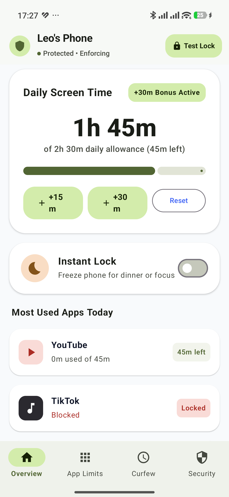
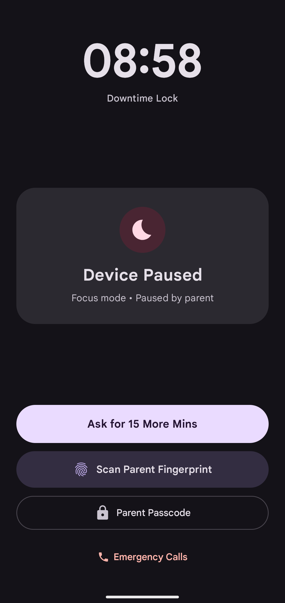
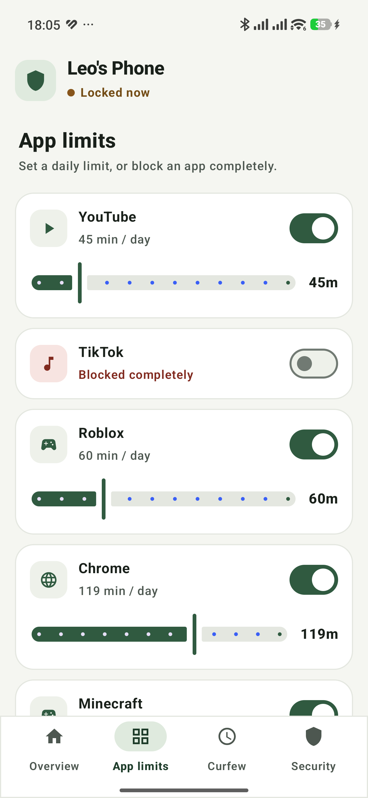
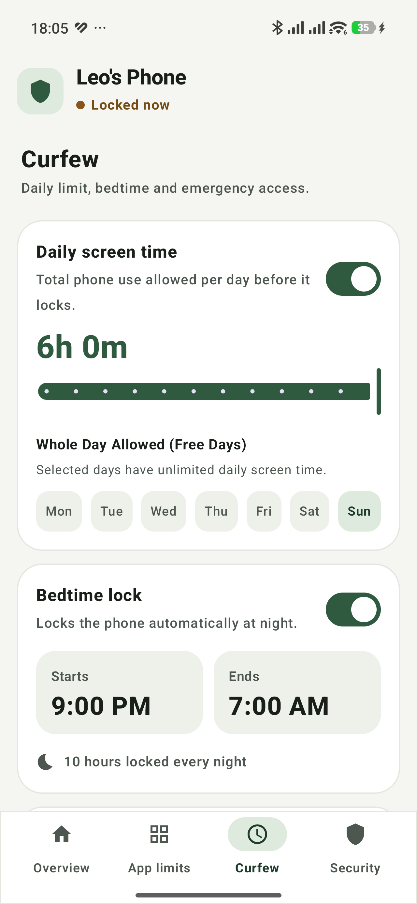
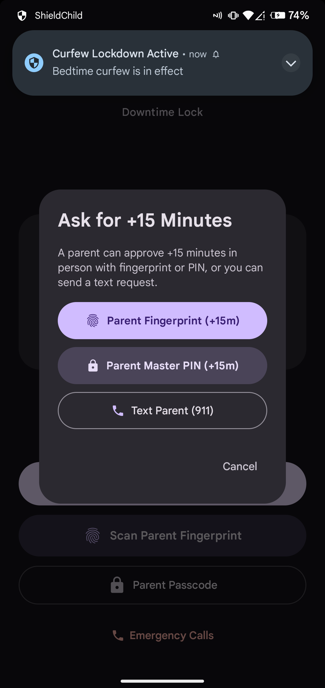
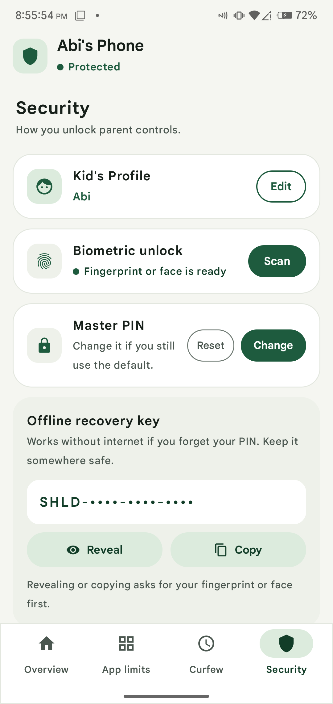
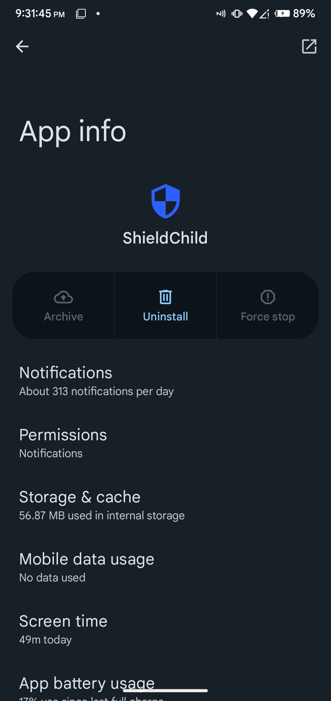

<p align="center">
  
</p>

<h1 align="center">ShieldChild</h1>

<p align="center">
  <strong>Parental controls kids cannot outsmart. 100% on-device.</strong><br>
  An Android parental control and bedtime lockdown app: whole-phone curfew across midnight,
  single-app time quotas, instant parent freeze, in-person +15m bonus approvals, and hardware-grade
  anti-uninstall armor. Built with Jetpack Compose and Material You. No account, no cloud servers, no ads, no tracking.
</p>

<p align="center">
  <a href="https://heyhadi.github.io/shieldchild/">Website</a> ·
  <a href="https://github.com/heyhadi/shieldchild/releases/latest">Download for Android</a> ·
  <a href="#what-it-does">What it does</a> ·
  <a href="#anti-bypass--anti-tamper-armor">Anti-Bypass Armor</a> ·
  <a href="#how-it-works">How it works</a> ·
  <a href="#install-on-android">Install</a> ·
  <a href="#development">Development</a> ·
  <a href="#test-suite">Test Suite</a> ·
  <a href="docs/privacy.html">Privacy</a>
</p>

<p align="center">
  &nbsp;&nbsp;&nbsp;&nbsp;
  &nbsp;&nbsp;&nbsp;&nbsp;
  
</p>

<p align="center"><sub>Authentic OnePlus 6 live device captures: Material You Parent Dashboard, Curfew Lockdown Screen, and Per-App Quota Controls.</sub></p>

*ShieldChild* is an open-source parental screen time and bedtime lockdown guardian designed with zero-bypass architecture. It runs 100% on the child's device without requiring cloud accounts, remote servers, or monthly subscriptions.

## What it does

|  |  |
|---|---|
| **Bedtime Curfew across Midnight.** Schedule overnight downtime (e.g. 9:00 PM – 7:00 AM) that automatically rolls across midnight. When curfew arrives, the entire phone is locked into an undismissible downtime screen. | **Anti-Uninstall & Anti-Tamper Armor.** Active Android Device Administrator disables and greys out the OS "Uninstall" and "Force Stop" buttons, preventing children from deleting the app even during daytime when they still have free screen time. |
| **Ask for +15 Mins.** When screen time expires, children can request extra time. Parents can approve +15 minutes in person with a fingerprint or Master PIN, or children can dispatch an emergency SMS request directly to a parent's phone. | **Sub-10ms Accessibility Deflection.** A high-speed background Accessibility watchdog listens to window transitions. Any attempt to access Android Settings, App Info, or Google Play is deflected back to Home under 10ms with the lock screen snapped on top. |
| **Single App Quotas & Pauses.** Set daily limits on distracting apps (YouTube, TikTok, games). Once an app's quota is reached, a polite blur shield pauses the app while keeping educational apps and dialers accessible. | **Instant Parent Freeze.** A single switch on the parent dashboard freezes the child's device immediately for family dinners, homework, or chores, overriding daily allowances until unlocked. |
| **Always-Available Emergency SOS.** A locked phone never leaves a child stranded. The lock screen features an Emergency Calls button that launches the native dialer directly to parents or emergency services (911). | **Offline Master Recovery Key.** If a parent forgets their Master PIN, a 16-character Master Recovery Key (e.g. `SHLD-9A4F-K82X-7M1P`) allows instantaneous PIN reset and unlock directly from the lock screen, completely offline. |
| **Reboot-Proof Persistence.** Children often restart devices to exploit startup delays. A high-priority `RECEIVE_BOOT_COMPLETED` receiver and Foreground Service lock the phone before launcher apps can even load. | **Material You (M3) Theming.** Expressive rounded squircle cards, Monet dynamic colors, pastel container elevations, and fluid animations designed to look native on Android 13, 14, and 15+. |
| **Biometric Authentication.** Instant parent unlock via fingerprint using Android's hardware-backed `BiometricPrompt` enclave, with automated fallback to the parent's salted Master PIN. | **100% On-Device & Private.** Zero telemetry, zero analytics, zero network transmission. Screen time calculations and parent policies exist exclusively within private encrypted storage on the phone. |

## Anti-Bypass & Anti-Tamper Armor

Children are remarkably creative at bypassing conventional screen time apps. ShieldChild was built specifically to close every known loophole:

1. **Anti-Uninstall During Allowed Screen Time (Device Administrator)**
   - *The Vulnerability:* Most parental control apps only block uninstall while the phone is locked. When the child has remaining screen time during the day, they go to Settings → Apps → Uninstall, or drag the app icon to the trash.
   - *ShieldChild's Armor:* Registered as an active **Device Administrator** (`DevicePolicyManager`). Android's operating system disables and greys out the native "Uninstall", "Archive", and "Force Stop" buttons system-wide.
   - *Parent Uninstall:* When a parent legitimately wants to uninstall, they authenticate with their Master PIN or fingerprint in the Security tab. ShieldChild temporarily releases the admin lock for 60 seconds (`allowParentUninstall`), allowing clean uninstallation.

2. **Sub-10ms Accessibility Interceptor**
   - *The Vulnerability:* Children tap navigation gestures or rapidly switch apps to slip past lock screens before they render.
   - *ShieldChild's Armor:* `ShieldAccessibilityService` monitors `TYPE_WINDOW_STATE_CHANGED` events. If a child attempts to open Device Admin settings, Accessibility settings, or package managers, the service immediately calls `performGlobalAction(GLOBAL_ACTION_HOME)` and snaps `CurfewLockActivity` on top in `< 10ms`.

3. **Reboot Lockdown Persistence**
   - *The Vulnerability:* Force-rebooting the phone gives children a window of several seconds where background monitoring services have not yet initialized.
   - *ShieldChild's Armor:* `BootReceiver` listens for `ACTION_BOOT_COMPLETED` and `ACTION_LOCKED_BOOT_COMPLETED`. It queries the curfew window and instant-freeze flags, immediately launching `CurfewLockActivity` via high-priority `FullScreenIntent` before the home launcher finishes displaying.

4. **Curfew Override System**
   - *The Vulnerability:* Granting +15m extension during scheduled bedtime hours often creates an infinite re-lock loop because the system clock is still within the bedtime window.
   - *ShieldChild's Armor:* ShieldChild implements `grantTemporaryCurfewOverride(minutes)` and `isCurfewOverrideActive()`. Watchdog services and dashboard activities honor active override timestamps, giving children exactly their allotted bonus time before re-locking.

5. **Gesture & Task Switcher Lockdown**
   - *The Vulnerability:* Swiping the home bar or opening the Recent Apps switcher allows children to sneak into background apps.
   - *ShieldChild's Armor:* `CurfewLockActivity` uses `launchMode="singleInstance"`, `excludeFromRecents="true"`, overrides `onUserLeaveHint()`, handles `onWindowFocusChanged()`, and closes system dialogs with `Intent.ACTION_CLOSE_SYSTEM_DIALOGS`.

<p align="center">
  &nbsp;&nbsp;
  &nbsp;&nbsp;
  &nbsp;&nbsp;
  
</p>

<p align="center"><sub>Live OnePlus 6 captures (left to right): Bedtime Curfew Schedule, +15m Bonus Approval Dialog, Parent Security Tab with Recovery Key, and Android OS App Info with Uninstall disabled.</sub></p>

## How it works

**Screen Time Accounting.** App usage and total screen time are queried directly from Android's hardware-backed `UsageStatsManager` (`UsageMonitor.kt`). Usage stats are aggregated into daily buckets, with bonus time balances tracked separately and reset cleanly at midnight.

**Curfew Math across Midnight.** Bedtime curfews frequently start before midnight (e.g. 21:00 / 9:00 PM) and end after midnight (e.g. 07:00 / 7:00 AM). `PolicyEngine.isWithinCurfewWindow` evaluates minute-of-day math across midnight boundaries:
```kotlin
if (startMinutes <= endMinutes) {
    currentMinutes in startMinutes until endMinutes
} else {
    currentMinutes >= startMinutes || currentMinutes < endMinutes
}
```

**Salted Cryptographic Authentication.** Master PINs are hashed using cryptographic salt digests (`ParentAuthManager.kt`). Failed authentication attempts trigger exponential progressive lockouts (1 attempt remaining → 30s lockout → 5m lockout). Offline recovery keys are formatted as 16-character uppercase codes (e.g. `SHLD-9A4F-K82X-7M1P`) and hashed with their own unique salts.

**Jetpack Compose & Material You.** The parent dashboard and child lockdown screens are written in pure Jetpack Compose using Material 3 dynamic color tokens (`Theme.kt`). The child lock screen features an ambient dark aesthetic with high-contrast emergency controls, while the parent dashboard features clean tonal squircle containers and fluid sliders.

## Install on Android

1. Download `app-release.apk` from the [latest GitHub release](https://github.com/heyhadi/shieldchild/releases/latest).
2. Install the APK on your child's phone and complete the 3-step Permission Setup wizard:
   - **Usage Access:** Allows ShieldChild to measure daily app screen time.
   - **Accessibility Service:** Enables sub-10ms anti-bypass deflection and tamper protection.
   - **Display over other apps:** Allows rendering curfew and single-app pause overlays.
3. Open the **Security** tab in the Parent Dashboard and tap **Activate Device Administrator**. This locks Android's native "Uninstall" button.
4. Set your 4-to-8 digit Parent Master PIN and write down your 16-character Emergency Master Recovery Key.

## Development

ShieldChild is an Android native app written in Kotlin with Jetpack Compose, paired with a TypeScript core policy rules engine.

```sh
# Clone the repository
git clone https://github.com/heyhadi/shieldchild.git
cd shieldchild

# Install dependencies for the TypeScript policy engine
npm install

# Run the policy rules test suite with coverage
npm test -- --coverage --watchAll=false

# Build the release Android APK
JAVA_HOME=/opt/homebrew/opt/openjdk@17 ./gradlew assembleRelease

# Install on a connected Android device or emulator via ADB
adb install -r app/build/outputs/apk/release/app-release.apk
```

- **Stack:** Android 14 / API 34 SDK, Kotlin 1.9, Jetpack Compose Material 3, AndroidX Biometrics, TypeScript, Jest.
- **Minimum Android Version:** Android 8.0 (Oreo, API 26). Target SDK: Android 14 (API 34).
- **Physical Device Verification:** Tested and verified on real OnePlus 6 (`245ac399`) running Android 13 / LineageOS.

## Test Suite

All policy rules, overnight curfew rollover math, bonus time extensions, anti-bypass gates, and offline recovery key resets are verified with Jest:

```sh
npm test -- --coverage --watchAll=false
```

```
PASS tests/policyRules.test.ts
  Curfew Window Calculation
    ✓ evaluates daytime curfew windows correctly
    ✓ evaluates overnight bedtime curfew windows correctly
  Screen Time Accounting
    ✓ calculates remaining time balance with bonus time
    ✓ detects when daily total limit is exceeded
  Device Lockdown Policy Evaluator
    ✓ enforces parent instant freeze over everything else
    ✓ enforces bedtime curfew when within curfew hours
    ✓ locks phone when daily screen time quota is exhausted
    ✓ allows device usage when within quota and outside curfew
  Single App Lock Evaluation
    ✓ blocks app if marked explicitly as isBlocked
    ✓ locks single app when daily limit reached
    ✓ keeps single app open when usage is below limit
    ✓ ignores unconstrained apps with 0 limit
  Formatters and Security Validators
    ✓ formats minutes cleanly into hours and minutes
    ✓ validates parent master PIN format
    ✓ validates emergency master recovery key format
    ✓ formats raw recovery keys cleanly into 4-character chunks
    ✓ validates child name correctly
  App Limits Management Logic
    ✓ filters installed applications by search query
    ✓ creates new AppLimit item correctly
    ✓ removes app limit from list
  Curfew Time Customization Formatters
    ✓ formats curfew times cleanly into 12-hour AM/PM format
    ✓ calculates duration in minutes across midnight
    ✓ formats curfew duration string cleanly
  Offline Emergency Recovery Key PIN Reset
    ✓ resets PIN successfully with valid recovery key
    ✓ rejects reset if recovery key is invalid
    ✓ rejects reset if recovery key length is invalid
    ✓ rejects reset if new PIN format is invalid
  Anti-Bypass Security Gate & Lock Screen Enforcement
    ✓ blocks parent dashboard access when parent is not authenticated
    ✓ enforces lockdown on third-party apps during curfew
    ✓ enforces lockdown even if child taps ShieldChild app without parent auth
    ✓ allows ShieldChild app to open only when parent is authenticated
    ✓ does not enforce lockdown when device is not locked
  Reboot Lockdown Persistence & Anti-Bypass
    ✓ re-enforces instant lock immediately upon reboot
    ✓ re-enforces scheduled bedtime curfew immediately upon reboot during night
    ✓ re-enforces daily screen time limit reached upon reboot
    ✓ does not lock on reboot if day is in unlimitedDays
    ✓ does not lock on reboot if within normal allowances and daytime
  Anti-Uninstall & Tamper Protection During Usage Time
    ✓ detects unauthorized attempt to uninstall via Package Installer when kid has screen time
    ✓ detects attempt to force stop or clear cache in Android Settings
    ✓ detects attempt to deactivate Device Admin or Accessibility in Settings
    ✓ detects attempt to uninstall from Google Play Store
    ✓ allows settings/uninstall screens when parent has explicitly authorized uninstall
    ✓ ignores third-party apps like YouTube or games during normal daytime
    ✓ validates OS-level uninstallation blocked if Device Admin is active
  Temporary Curfew Extension & Override (+15m Bonus)
    ✓ validates whether temporary curfew override timestamp is currently active
    ✓ allows device usage during bedtime curfew when parent has granted an extension
    ✓ instant freeze still takes absolute priority even if parent extension is active
    ✓ evaluateRebootLockdown unlocks device if parent extension is currently active

----------------|---------|----------|---------|---------|-------------------
File            | % Stmts | % Branch | % Funcs | % Lines | Uncovered Line #s 
----------------|---------|----------|---------|---------|-------------------
All files       |     100 |      100 |     100 |     100 |                   
 policyRules.ts |     100 |      100 |     100 |     100 |                   
----------------|---------|----------|---------|---------|-------------------
Test Suites: 1 passed, 1 total
Tests:       48 passed, 48 total
Snapshots:   0 total
Time:        0.457 s
Ran all test suites.
```

## Privacy & Safety

ShieldChild requires **no account**, contains **no ads**, and sends **no telemetry**. All data stays on the child's device. Read the full [Privacy Policy](docs/privacy.html).

## License

ShieldChild is open-source software licensed under the [MIT License](LICENSE).
