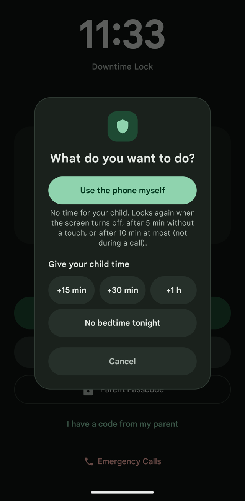
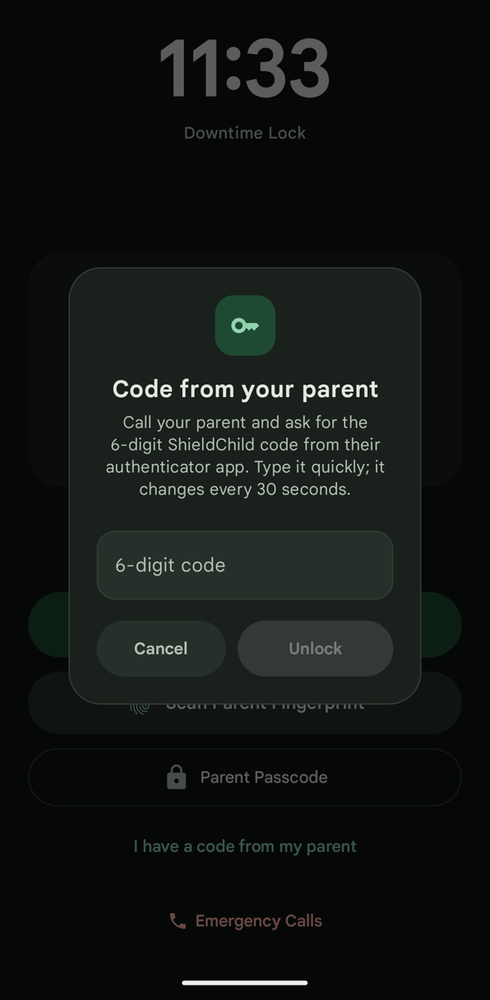
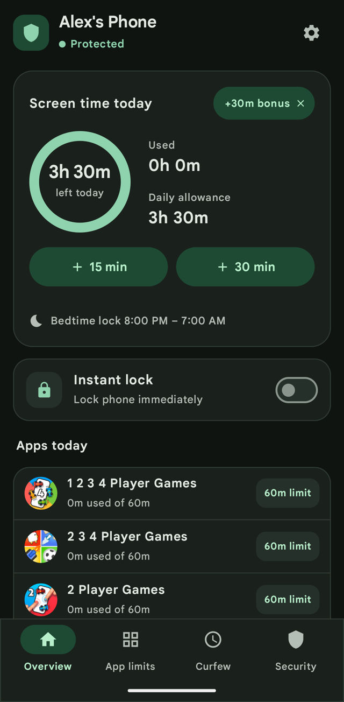
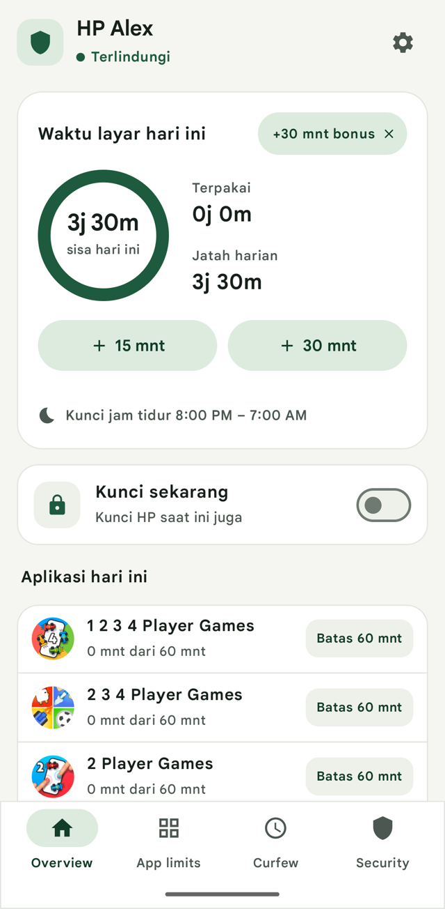

<p align="center">
  
</p>

<h1 align="center">ShieldChild</h1>

<p align="center">
  <strong>Screen time and bedtime controls for your child's Android phone. 100% on-device.</strong><br>
  Lock the whole phone at bedtime or when the daily allowance runs out, limit single apps, give extra
  time on the spot or from far away with a one-time code. No account, no servers, no ads, no tracking.
</p>

<p align="center">
  <a href="https://heyhadi.github.io/shieldchild/">Website</a> ·
  <a href="https://github.com/heyhadi/shieldchild/releases/latest">Download for Android</a> ·
  <a href="#what-it-does">What it does</a> ·
  <a href="#unlocking-and-extra-time">Unlocking & extra time</a> ·
  <a href="#what-it-protects-against">Protection</a> ·
  <a href="#install">Install</a> ·
  <a href="#development">Development</a> ·
  <a href="docs/privacy.html">Privacy</a>
</p>

<p align="center">
  <a href="https://github.com/heyhadi/shieldchild/actions/workflows/android.yml"></a>
</p>

<p align="center">
  &nbsp;&nbsp;&nbsp;&nbsp;
  &nbsp;&nbsp;&nbsp;&nbsp;
  
</p>

<p align="center">
  &nbsp;&nbsp;
  &nbsp;&nbsp;
  &nbsp;&nbsp;
  
</p>

<p align="center"><sub>Captured on a OnePlus 6 (1.0.9): dashboard, lock screen, app limits, the choice after a parent signs in, a remote code, dark mode and Indonesian.</sub></p>

ShieldChild is an open-source Android app that runs entirely on the child's phone. The parent sets it up once on that phone, protected by a PIN (and optionally their fingerprint), and everything — rules, screen time, the unlock log — stays there.

## What it does

|  |  |
|---|---|
| **Daily screen time.** Set a daily allowance (e.g. 2 hours). When it runs out, the whole phone locks until tomorrow. Turn the limit off, or pick free days (e.g. Saturday and Sunday) with no limit. | **Bedtime lock.** Lock the phone every night (e.g. 8:00 PM – 7:00 AM), across midnight. |
| **App limits.** Give single apps their own daily limit, or block them completely. Other apps keep working. | **Instant lock.** One switch locks the phone right now, for dinner or homework. |
| **Calls always work.** The lock screen has Emergency calls (Android's own emergency dialer, 112/911/995) and, if you add your number, Call parent and Text parent. An incoming call is never covered. | **Unlock log.** Every unlock and every bit of extra time is listed with how it was done and when, so you notice a PIN that leaked. |
| **Light and dark mode, English and Indonesian.** Pick them in Settings, independent of the phone's own settings. | **Updates from GitHub.** Settings → App updates downloads a newer version and only installs it if it's signed by the same developer. |

## Unlocking and extra time

Signing in on the lock screen (PIN or fingerprint) never gives your child time by itself. You choose:

- **Use the phone myself** — a parent session. The phone works for you, your use doesn't count against your child, and it locks again when the screen turns off, after 5 minutes without a touch, or after 10 minutes at most (never during a call). Blocked apps stay blocked.
- **+15 min / +30 min / +1 h** — lifts only the lock that's on (bedtime or the daily limit), with a warning 5 minutes and 1 minute before it ends.
- **No limit for the rest of today** / **No bedtime tonight**.
- **Turn off instant lock** — only shown when you locked the phone yourself.

**Away from home?** Turn on *Security → Remote unlock code*, scan the QR code with Google Authenticator (or any authenticator app) on your phone, and confirm. When your child calls, read them the 6-digit code; they type it on the lock screen under *I have a code from my parent*. A code gives 15 minutes (30 min or 1 hour if you prefer), works once, at most 3 times a day, and works with no internet on either phone. It can't lift an instant lock.

**Forgot your PIN?** At setup ShieldChild shows a 16-character recovery key once. Write it down: it resets the PIN from the lock screen, offline. You can create a new one in Security (it asks for your PIN).

## What it protects against

Honest list. Without *Device Owner* mode (below) a determined child with time and technical knowledge can still get around some of it.

| Trick | Protected? |
|---|---|
| Uninstalling ShieldChild, force stop, clearing its data | ✅ Device Administrator blocks uninstall; the tamper guard sends ShieldChild's App info, Accessibility and Device admin screens back to Home and locks the phone |
| Swiping home, Recents, rebooting | ✅ The lock comes back straight away, and after a reboot before the home screen settles |
| Changing the phone's clock or time zone to skip bedtime | ✅ With automatic time off, a manual jump locks the phone until a parent unlocks it, and shows up in the unlock log |
| Guessing the PIN | ✅ 5 wrong tries (PIN, recovery key or remote code) lock entry for 15 minutes |
| Their own fingerprint | ✅ Fingerprint unlock turns itself off when a new fingerprint is added. Only turn it on if your child has no fingerprint on the phone |
| Seeing the PIN or recovery key | ✅ Screenshots and the Recents preview of ShieldChild's screens are blocked |
| Switching to another user profile on the phone | ⚠️ ShieldChild protects the profile it's installed in. Device Owner mode blocks adding and switching users |
| Safe mode, adb, a factory reset | ⚠️ Only with Device Owner mode (safe mode, uninstall and app-control restrictions). A factory reset always removes the app |
| A second phone or a friend's phone | ❌ Out of scope |

### Device Owner mode (strongest)

On a phone **with no Google or other accounts added yet** (e.g. right after a reset), install ShieldChild, finish setup, then from a computer:

```sh
adb shell dpm set-device-owner com.shieldchild.app/.service.ShieldDeviceAdminReceiver
```

ShieldChild then also blocks safe mode, adding or switching users, uninstalling apps and clearing app data (for all apps, so do app housekeeping before you turn it on). Removing Device Owner needs a factory reset.

## Install

1. On the child's phone, download `shieldchild.apk` from the [latest release](https://github.com/heyhadi/shieldchild/releases/latest) and install it (Android 8 or newer; allow installs from your browser when asked).
2. Open ShieldChild and follow the 3 setup steps: your child's name and daily allowance; your PIN, optional fingerprint and your phone number; then the permissions:
   - **Usage access** — measures screen time.
   - **Accessibility** — notices app switches instantly and guards ShieldChild's settings.
   - **Display over other apps** — shows the lock screen and app pauses.
   - **Device admin** — blocks uninstalling.
   - **Notifications** — lets the lock appear immediately and shows time warnings.
3. Write down the recovery key ShieldChild shows you.
4. Optional: set up the remote unlock code in Security.

Later versions install from **Settings → App updates** (1.0.1 and newer). On some phones (e.g. LineageOS) you first need to allow ShieldChild's internet access in Android Settings → Apps → ShieldChild → Mobile data & Wi-Fi. ShieldChild only goes online when you tap *Check for updates*.

## Development

Kotlin and Jetpack Compose, one module (`app/`). Requires JDK 17 and the Android SDK.

```sh
git clone https://github.com/heyhadi/shieldchild.git
cd shieldchild
./gradlew testReleaseUnitTest assembleRelease
adb install -r app/build/outputs/apk/release/app-release.apk
```

- **Tests:** `./gradlew testReleaseUnitTest` runs the Kotlin unit tests (lock rules, PIN and recovery key, TOTP codes against the RFC 6238 vectors, remote codes, parent sessions, screen-time counting, clock-change detection, update tags). `src/` still holds an older TypeScript copy of the rules with its Jest tests (`npm test`); the Kotlin tests are the ones that cover the app.
- **Signing:** release builds are signed when `local.properties` (or the environment) has `SHIELD_STORE_PASSWORD`, `SHIELD_KEY_PASSWORD`, `SHIELD_KEY_ALIAS` and the keystore is at `app/shieldchild-release.jks` (or `SHIELD_STORE_FILE`). Without them you get an unsigned APK. Never commit the keystore or passwords.
- **CI:** `.github/workflows/android.yml` runs the tests and builds on every pull request. Every push to `main` publishes a signed GitHub Release tagged `v1.0.<build>-<build>`; the number after the dash is what the in-app updater compares.
- **Texts:** all UI text is in `app/src/main/res/values/strings_ui.xml` (English) and `values-in/strings_ui.xml` (Indonesian, casual "kamu" tone). Use `str(R.string.…)` in code.
- **Colours:** use `Shield.colors.…` (`ui/theme/Color.kt`), never hex values in screens, so light and dark mode keep working.

## Privacy

No account, no ads, no analytics. Rules, screen time and the unlock log never leave the phone. The only network request is the update check you start yourself. Read the full [privacy policy](docs/privacy.html).

## License

[MIT](LICENSE)
